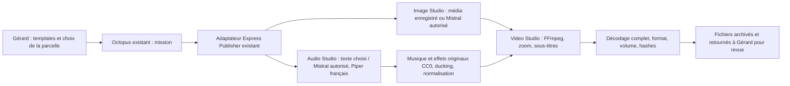

# Production audiovisuelle de Gérard — 26 octobre 2026

## Résultat livré et chemin réel

Un vrai Short 420 Dice de **18 secondes** est livré dans [docs/demos/420-dice/short.mp4](../demos/420-dice/short.mp4), avec son [rapport](../demos/420-dice/report.json), ses sous-titres SRT, son script et son poster. Il contient le visuel officiel du dépôt du jeu, une narration française effectivement synthétisée, une composition instrumentale originale, des ponctuations sonores et six sous-titres synchronisés. Aucun fournisseur n'est simulé pour la production de ce fichier. Le texte est un script de démonstration préparé d'après les règles officielles, **pas une génération Mistral revendiquée**.



Aucun second agent, service de rendu distant ou moteur Octopus n'est ajouté. Les capacités `image.studio`, `audio.studio`, `video.studio` passent par le même adaptateur. Le calcul reste dans le runtime Node local : FFmpeg/Piper ne sont pas supposés disponibles dans Cloudflare Workers. L'ancien prototype vidéo Natasha et les circuits sociaux ne sont ni supprimés ni remplacés.

## Audit des capacités existantes

| Composant | État constaté et réutilisation | Limite de preuve |
| --- | --- | --- |
| Templates Poulpe | Image déjà déclarée, audio/video descriptifs sans moteurs ; raccordés à l'adaptateur | Aucune seed réelle n'est activée par cette PR |
| Mistral texte | `services/mistral-text.ts` existe, réutilisé pour produire un script JSON par parcelle | Permission `mistral.text` requise ; appels testés avec réponses simulées, aucune consommation réelle revendiquée |
| Mistral image | Worker existant : agent technique image → conversation → fileId → téléchargement ; réutilisé | Identifiant seul insuffisant : téléchargement et décodage obligatoires. Prompt par parcelle obligatoire, ancien défaut 420 Dice supprimé |
| Canva | Connexions et découverte existent, création de conteneur/design distincte d'un export image | Aucun crédit ni export réel consommé pour ce test ; pas de fallback automatique vers Canva |
| ElevenLabs | Détection de connexion existe ; aucune chaîne voix/mix/export vérifiée dans ces fichiers | Connexion ou quota inconnu ne vaut pas réussite TTS ; aucune consommation réelle |
| Piper français | Modèle SIWIS installé et synthèse réelle des six phrases | Hash du modèle vérifié ; seul ce modèle français et sa licence sont validés ici |
| FFmpeg | Montage et contrôles réels, H.264/AAC, 9:16, zoom, sous-titrage | Animation de visuel existant, pas de nouvelle scène générée ni de gameplay filmé |
| GitHub | CI et runtime déjà présents, étendus pour validation/installation conditionnelle/archives | Aucun nouveau workflow ni calendrier, cron et déclencheurs conservés |

L'environnement de travail ne possède aucun identifiant Mistral/Composio prêt. Trois lectures de diagnostics déployés ont été tentées le 26/10 à 18:03 UTC ; elles étaient inaccessibles depuis cet environnement. La CI existante effectue séparément ces mêmes GET et conserve un relevé expurgé, sans exécution de fournisseur. Les résultats de ce relevé seront consignés dans la PR ; aucun statut de connexion n'est inventé pour combler un blocage réseau.

## Fichiers et garanties techniques

- Entrée générique `studio-v1` : identités de parcelle/seed/opération, titre mobile, durée 8–60 s, média enregistré ou prompt explicitement autorisé, phrases/sous-titres et provenance. Aucun produit n'est inscrit dans les moteurs.
- Médias enregistrés dans `data/studio-inputs/assets.json` : parcelle propriétaire, SHA-256, fichier local borné au répertoire du catalogue, droits et recadrage vérifiés. Pas d'URL ni de chemin arbitraire dans une mission.
- Image normalisée à 1080 × 1920 sans déformation ; conservation de la source et de sa provenance. Le chemin Mistral historique Poulpe vérifie également le décodage réel.
- Voix Piper française SIWIS : modèle SHA-256 `641d1ab097da2b81128c076810edb052b385decc8be3381814802a64a73baf99`. Volume de chaque phrase vérifié ; narration trop longue ou silencieuse rejetée, pas de coupe cachée de la fin du texte.
- Musique et effets synthétisés localement sans échantillon tiers : composition originale CC0. Sidechain pour baisser la musique sous la voix ; master WAV stéréo 48 kHz normalisé par deux passes EBU R128, cible −16 LUFS et plafond −1,5 dBTP.
- Sous-titres ASS incrustés et SRT conservés. Les durées sont celles des fichiers TTS par phrase ; le dernier appel à l'action reste affiché jusqu'à la fin. Ce n'est pas un alignement mot à mot.
- MP4 contrôlé : décodage complet, H.264/yuv420p, AAC stéréo 48 kHz, 30 fps, durée et dimensions exactes, niveau sonore et crête après encodage AAC, plusieurs images échantillonnées distinctes. Poster inspecté visuellement ; le média source reste une capture de résolution limitée.
- Réservation du répertoire avant toute génération, conflit d'identité/contenu et résultat incertain explicites, aucune relance automatique d'un fournisseur. Rapport `ready-for-review` uniquement après vérification des fichiers. Fichier manquant/altéré ne devient jamais un succès.
- Téléchargements locaux uniquement, routes de rendu et d'artefacts inaccessibles via un proxy public. Aucun point d'entrée de publication ajouté.

Le catalogue expose les dépendances disponibles, pas une promesse d'accès à chaque fournisseur. Une permission Mistral explicite ne prouve ni un solde de crédits ni un tarif gratuit : ces coûts restent inconnus tant qu'ils ne sont pas mesurés. Le parcours démontré utilise **zéro appel externe payant**, avec un coût de calcul local non mesuré.

## Reproduire sans dépense fournisseur

```sh
python3 -m venv .studio-venv
.studio-venv/bin/pip install 'piper-tts==1.8.0'
python3 scripts/setup-studio-voice.py
export PIPER_BIN="$PWD/.studio-venv/bin/piper"
export PIPER_MODEL="$PWD/data/studio-models/fr_FR-siwis-medium.onnx"
pnpm --filter @workspace/scripts exec tsx ./render-short.mts ../examples/studio/420-dice.json
```

FFmpeg, ffprobe et DejaVu Sans doivent être installés. Le script de setup télécharge le modèle et sa fiche de licence par le proxy configuré, vérifie son hash et ne crée ni abonnement ni tâche planifiée. Les données temporaires et modèles sont ignorés par Git ; les médias d'entrée et la démonstration sont versionnés séparément.

La production locale conserve **tous** les fichiers, demandes, masters, pistes voix/musique/effets, scripts et hashes dans `data/studio/jobs/<id>`. Le client Poulpe conserve le MP4, l'image, les masters et pistes audio, le script, le SRT, le poster, la mission et le rapport dans `garden/studio/`. Le mécanisme existant de conservation d'état prend ces fichiers en charge quand le cycle est activé. Un template inchangé réutilise son archive vérifiée ; un changement de configuration crée une nouvelle production. Les médias ne sont pas inscrits dans une file de publication.

## Tests et preuves réellement exécutés

- API : **84 tests réussis**, dont sept nouveaux tests des autorisations, absence d'appel implicite, provenance, isolement des parcelles, faux PNG, réservation d'opération et contrôle audio/sous-titres. Le faux PNG est reconnu comme image par ffprobe mais échoue au décodage FFmpeg : la réussite n'est donc pas fondée sur son en-tête.
- Poulpe : **135 tests réussis**, dont quatre nouveaux tests des templates génériques, permissions, mauvais résultats et archive réutilisée avec contrôle de hash. Build réussi après installation des dépendances ; la première tentative locale signalait `vite: not found`, corrigé par l'installation déclarée, sans modification du lockfile livrée.
- Worker : **134 tests réussis / 1 ignoré**, TypeScript réussi ; le test ajouté exige un prompt explicite et vérifie zéro appel fournisseur quand il manque. Le test Postgres reste ignoré sans TEST_DATABASE_URL.
- Build/types Publisher : réussi, sans DB push. Avertissements préexistants de sourcemaps et taille de bundle conservés.
- [Preuve du parcours réel](2026-10-26-studio-e2e-proof.json) : vrai client Poulpe, Octopus existant compilé, routes Express, Piper et FFmpeg, téléchargement et archive ; **aucun moteur de rendu simulé et aucun appel réseau externe autorisé**. Deuxième demande sans nouvelle mission ; fichier altéré rejeté. La première tentative du test attendait HTTP 200 au lieu du 201 d'enregistrement Octopus : assertion corrigée, moteur inchangé.
- Short livré : métadonnées, volume, hashes et droits exacts dans [son rapport](../demos/420-dice/report.json). Son hash diffère de celui du rendu E2E, qui est une production indépendante ; la synthèse vocale peut varier entre rendus.

## Droits et limites restantes

Le visuel provient de `benoitlub/420-dice-game-reboot`, commit `bf315300db5c5ab580c6f86bb14ae56d884b6739`. Le propriétaire a demandé cette démonstration ; aucune licence de diffusion publique ou autorisation de publication sociale n'est déduite de cette demande. Le rapport conserve cette restriction. Voix : SIWIS French Speech Synthesis Database, University of Edinburgh, via Piper fr_FR-siwis-medium, **CC-BY 4.0**, attribution conservée. Musique et bruitages originaux : **CC0-1.0**.

Fonctionne réellement : production locale complète avec médias et texte disponibles, français, mixage, sous-titres, MP4 et archive. Fonctionne sous test simulé seulement : réponses de génération Mistral. Non démontré ici : génération externe Mistral/Canva/ElevenLabs, quotas/crédits de ces comptes, qualité créative de toutes les parcelles ou génération vidéo sémantique par Kling/Morphic.

Pour la mise en service restent la revue/mise à disposition des deux PR, la configuration des médias et droits des autres parcelles, puis l'activation explicite AV du cycle existant si souhaitée. Aucun déploiement ni fusion n'est effectué. La revue créative et l'écoute humaine restent nécessaires avant une autorisation distincte de diffusion. Aucun nouveau compte/abonnement, secret, budget, cron ou publication programmée modifié. **Zéro publication envoyée.**
